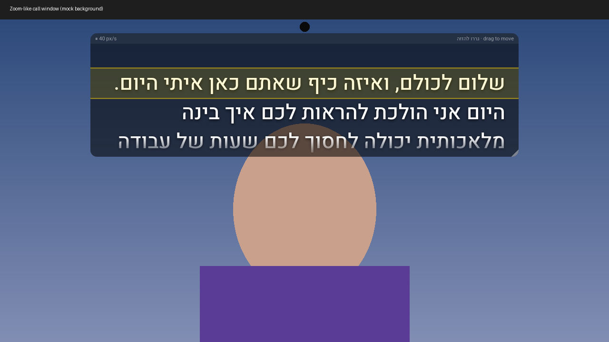

# Overlay Prompter · טלפרומפטר שכבה



---

## עברית

### מה זה?
טלפרומפטר שקוף שיושב **מעל כל אפליקציה** — זום, טימס, TikTok Live Studio, אפליקציות פילטרים למצלמה — כדי שתוכלי לקרוא את התסריט שלך ולהמשיך להסתכל למצלמה. החלון ממוקם כברירת מחדל למעלה במרכז, ליד המצלמה. תמיכה מלאה בעברית ובכיוון ימין-לשמאל, עם הגופן Heebo.

### התקנה (מפתחים)
1. התקינו [Node.js](https://nodejs.org) גרסה 18 ומעלה.
2. בתיקיית הפרויקט: `npm install` ואז `npm start`.
3. בניית קובץ התקנה: `npm run dist:win` (Windows, NSIS) או `npm run dist:mac` (macOS, DMG — חייבים לבנות על מק).

### איך משתמשים
- בחלון **לוח הבקרה**: הדביקי טקסט או טעני קובץ ‎.txt/‎.md, תני כותרת ולחצי "שמור והצג". התסריטים וההגדרות נשמרים במחשב.
- גררי את החלון מהפס העליון, ושני גודל מהפינה התחתונה.
- הפעילי **לחיצה דרך החלון** (Ctrl+Shift+L) כדי לעבוד באפליקציה שמתחת.

### קיצורי מקלדת (עובדים גם כשאפליקציה אחרת בפוקוס; במק Ctrl = Cmd)
| קיצור | פעולה |
|---|---|
| Ctrl+Shift+Space | נגן / עצור |
| Ctrl+Shift+↑ / ↓ | מהירות + / − |
| Ctrl+Shift+← / → | אחורה / קדימה 3 שורות |
| Ctrl+Shift+R | חזרה להתחלה |
| Ctrl+Shift+H | הסתר / הצג |
| Ctrl+Shift+L | לחיצה דרך החלון |
| Ctrl+Shift+= / - | גודל גופן |

### טיפים
- **זום / טימס**: האפליקציה מסתירה את עצמה משיתוף מסך (ראו מגבלות). בכל זאת, עדיף לשתף **חלון מסוים** ולא מסך מלא. קרבי את החלון למצלמה וצמצמי לשתיים-שלוש שורות כדי שהעיניים כמעט לא יזוזו.
- **TikTok Live Studio**: אם את משדרת "לכידת מסך", בדקי בתצוגה המקדימה שהטקסט לא נראה. אם הוא נראה — עברי ללכידת חלון/מצלמה בלבד.
- **אפליקציות פילטר**: הפילטר משפיע רק על המצלמה; הטקסט על המסך שלך בלבד.
- שקיפות רקע נמוכה + קו קריאה צהוב = הכי נוח לעיניים.

### מגבלות (בכנות)
- הסתרה משיתוף מסך משתמשת ב־`setContentProtection`: ב-Windows עובד מ-Windows 10 גרסה 2004 ומעלה; במק עובד ברוב כלי הלכידה, אבל ב-macOS 15+ חלק מכלי הלכידה החדשים (ScreenCaptureKit) **עלולים עדיין לראות את החלון**. גם צילום מצלמה חיצונית של המסך כמובן יראה אותו. **תמיד לבדוק לפני שידור.**
- על מסך מלא אמיתי של אפליקציות מסוימות (בעיקר משחקים/מצב בלעדי) החלון עלול לא להופיע מעל.
- קיצור מקלדת שתפוס ע"י אפליקציה אחרת לא יירשם (תופיע הודעה ביומן).
- נבדק עד כה רק על Linux בסביבה וירטואלית — ההתנהגות ב-Windows/Mac טרם נבדקה בפועל.

### מפת דרכים
- 🎙 **מעקב קולי** (לא קיים עדיין): גלילה שעוקבת אחרי הדיבור שלך בעברית.
- ספירה לאחור לפני התחלה, הדגשות וצבעים בתסריט, בחירת מסך, שלט רחוק מהטלפון.

---

## English

### What it is
A transparent, always-on-top teleprompter that floats **over any app** (Zoom, Teams, TikTok Live Studio, camera-filter apps) so you can read your script while looking at the camera. Defaults to top-center, near the webcam. Hebrew/RTL first, bundled Heebo font.

### Install (dev)
```bash
npm install
npm start
npm run dist:win   # Windows NSIS installer
npm run dist:mac   # macOS DMG (build on a Mac)
```
If your npm blocks install scripts, run `node node_modules/electron/install.js` once to download the Electron binary.

### Features
Smooth time-based auto-scroll · speed +/- · play/pause · jump back/forward · font size · background opacity · mirror (for glass rigs) · RTL toggle · highlighted reading line · click-through · hide/show · saved scripts list · load .txt/.md · settings & window position remembered · mouse-wheel scrubbing.

### Global hotkeys (Ctrl = Cmd on macOS)
| Hotkey | Action |
|---|---|
| Ctrl+Shift+Space | Play / pause |
| Ctrl+Shift+Up / Down | Speed + / − |
| Ctrl+Shift+Left / Right | Jump back / forward 3 lines |
| Ctrl+Shift+R | Restart |
| Ctrl+Shift+H | Hide / show overlay |
| Ctrl+Shift+L | Toggle click-through |
| Ctrl+Shift+= / - | Font size |

### Zoom / Teams / TikTok tips
- Share a **specific window**, not the whole screen, as a second safety layer.
- Keep the overlay small (2–3 lines) right under the webcam so your eye-line barely moves.
- TikTok Live Studio "screen capture" sources: check the preview — if the text shows, use window/camera capture instead.

### Limitations
- Screen-share hiding uses `win.setContentProtection(true)`: Windows 10 2004+ (`WDA_EXCLUDEFROMCAPTURE`) and macOS (`NSWindowSharingNone`). Some capture paths (notably ScreenCaptureKit-based tools on newer macOS, some OBS capture modes, older Windows) **may still see it**. Always test before going live.
- Exclusive-fullscreen apps/games may draw above it.
- Global hotkeys already claimed by another app fail to register (logged, non-fatal).
- Transparent windows on Windows cannot be resized by their edges — use the bottom-right grip.
- Only verified on Linux under Xvfb so far; Windows/macOS behavior is untested.

### Roadmap
- **Voice-follow mode — not implemented.** The panel toggle is disabled on purpose. Plan in `AGENTS.md`.
- Countdown, cue colors/markdown, monitor picker, phone remote.

### For AI assistants / contributors
See [AGENTS.md](AGENTS.md) and [CONTRIBUTING.md](CONTRIBUTING.md). License: MIT.
